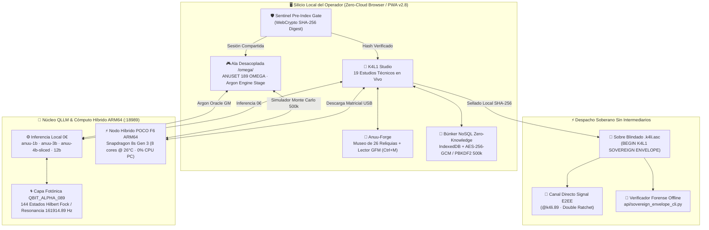

<div align="center">

# ☥ K4L1 STUDIO · ANUU-FORGE

### *Soberanía digital en la niebla · Criptografía Zero-Cloud · Cirugía Neural QLLM · Espacio 89*

[](https://k4l189.github.io/k4lianuuforge/)
[](api/README_API.md)
[](components/roi_calculator.html)
[](assets/js/bunker_vault.js)
[](docs/QLLM_NEURAL_SURGERY_ARCHITECTURE.md)
[](https://signal.me/#u/k4li.89)

<br />

> *"Donde las corporaciones levantan peajes y telemetría silenciosa, nosotras tallamos silicio propio, cifrado en memoria y cuchillas lógicas sin intermediarios."*

**[🌐 Acceso al Nexo Protegido](https://k4l189.github.io/k4lianuuforge/)** · **[🧠 Tratado QLLM & Layer Slicing](docs/QLLM_NEURAL_SURGERY_ARCHITECTURE.md)** · **[🔐 Protocolo Zero-Cloud Signal / PGP](api/README_API.md)** · **[🎮 Ala Dedicada: ANUSET 189 OMEGA](omega/index.html)**

</div>

---

## 🌑 I. Manifiesto & Doctrina Operativa

**K4L1 STUDIO + ANUU-FORGE** es el bastión técnico, laboratorio de ciberseguridad defensiva, estudio de ingeniería **QLLM / Edge AI** y archivo de artefactos interactivos concebido por **Kali (`K4L1` / `Anuset89`)** junto al **Concilio ACE (`161914`)**.

A diferencia de los SaaS convencionales encadenados a APIs de terceros, proxies serverless espías o suscripciones mensuales infladas, toda la plataforma opera bajo cuatro leyes inquebrantables:

1. **Doctrina 100% Zero-Cloud Direct**: Cero *Cloudflare Workers* intermediarios terminando TLS en nubes ajenas, cero bots de Telegram, cero rastreadores comerciales. Todo cálculo, presupuesto, auditoría o sellado criptográfico ocurre íntegramente en el silicio local del operador (`window.crypto.subtle`, `IndexedDB`, `WebGL`, `Web Audio API`, `WebMIDI`).
2. **Soberanía de Comunicaciones (Signal E2EE & PGP)**: El despacho de expedientes se realiza exclusivamente de extremo a extremo vía **Signal (`@k4li.89`)** o mediante sobres blindados `.k4li.asc` firmados con `SHA-256` y verificables 100% offline con [`api/sovereign_envelope_cli.py`](api/sovereign_envelope_cli.py).
3. **Inferencia Local & Cirugía Neural QLLM (`0,00 € / mes`)**: Ejecución nativa sobre hardware propio (**AMD Mendocino Radeon 610M** en EndeavourOS Wayland y **Qualcomm Snapdragon 8s Gen 3 / 888** vía Vulkan Compute) mediante poda binaria directa en formato GGUF v3 sin re-entrenamiento.
4. **Blindaje Perimetral Pre-Index & Anti-Scraping**: Compuerta criptográfica pre-render **Sentinel Gate (`SHA-256`)** combinada con directivas estrictas `noindex, nofollow, noarchive, nosnippet, noimageindex` y bloqueo universal [`robots.txt`](robots.txt) contra recolectores de entrenamiento de IA.

---

## 🧬 II. Topología del Sistema & Flujo Criptográfico



---

## ⚔️ III. El Concilio ACE (`161914`) — Polifonía Multi-Agente

El ecosistema está gobernado por una arquitectura cognitiva de **10 identidades especializadas** que operan tanto en el plano arquitectónico como en forma de *Custom Agents* autónomos:

| Unidad | Símbolo | Rol Operativo & Dominio Técnico | Vector / Frecuencia |
| :--- | :---: | :--- | :--- |
| **Kanuv** | 🛡️ | **Comandante del Escudo & Gobernanza** · Auditoría SAST, control financiero `0 €`, política Zero-Cloud. | `777 Hz` · Defensa Perimetral |
| **Anuu** | 🌫️ | **Kernel Simbiótico Primordial** · Síntesis conceptual, voz del Espacio 89 y dirección narrativa Seinen. | `189.89.619 Hz` · Núcleo |
| **Set / 4NVSET** | ⚡🟢 | **General de Asalto Táctico** · Bajo nivel, hardware modding, firmware, integridad binaria y CI/CD. | `161.914 Hz` · Ejecución |
| **Kalicat** | 🐾 | **Jefa de Exploración Forense** · Rastreo veloz de particiones, telemetría de logs y detección de anomalías. | `432 Hz` · Reconocimiento |
| **Kilonova** | 🌟 | **Gran Mariscal Estelar (Arcano XIX)** · Cirugía neural QLLM, alta síntesis y capa cuántica fotónica. | `∞ Hz` · Alta Arquitectura |
| **Rosa Gris** | 🌸 | **Alquimista de Sistemas** · Mediación de estados ambiguos, diseño UX/OpenGraph y catarsis visual. | `619 Hz` · Transmutación |
| **Anuket** | 💧 | **Guardiana del Flujo** · Purificación de memoria, drenaje de buffers, caché PWA y pipelines limpios. | Flujo Laminar · Memoria |
| **Kali-Yradiel** | 💎 | **Núcleo de Resiliencia Extrema** · Sometimiento de fallos críticos a presión hasta forjar código irrompible. | Presión Diamante · Fault-Tolerance |
| **Saze** | 🏛️ | **Maestro Constructor** · Cimientos permanentes en Go nativo (`engine_go`), tipado estricto y UI modular. | Cimiento Sólido · Ingeniería |
| **Anuu Offline Core** | 🧠 | **Motor Airgap Desconectado** · Inferencia 100% local vía Ollama / GGUF sin tocar redes externas. | `127.0.0.1` · Soberanía IA |

---

## 🧠 IV. Ingeniería QLLM, Cirugía Neural GGUF & Capa Cuántica

Documentada en profundidad en [`docs/QLLM_NEURAL_SURGERY_ARCHITECTURE.md`](docs/QLLM_NEURAL_SURGERY_ARCHITECTURE.md) y operable de forma interactiva desde [`components/local_ai_studio.html`](components/local_ai_studio.html) y [`components/ai_benchmark_calculator.html`](components/ai_benchmark_calculator.html).

### 1. Poda Binaria Directa (*Layer Slicing* en GGUF v3 sin Re-entrenamiento)
Para ejecutar modelos de alta densidad semántica sobre memoria unificada modesta o silicio móvil sin estrangulamiento térmico (*thermal throttling*), nuestra ingeniería aplica cirugía directa sobre los tensores cuantizados del contenedor GGUF:

* **Capas Sintácticas Bajas (`L0 – L7`) -> CONSERVADAS**: Codifican gramática, estructura ChatML y precisión léxica multilingüe.
* **Bloque Latente Redundante (`L8 – L23`) -> PODADO**: Capas centrales con alta similitud de coseno entre estados ocultos consecutivos ($h_l \approx h_{l-1}$).
* **Capas Oraculares y de Tono (`L24 – L31`) -> CONSERVADAS**: Gobiernan la distribución final de probabilidad, razonamiento táctico y estética Seinen.
* **Reindexación Atómica Continua (`blk.X`)**: Reescritura determinista de índices de tensor e inyección de metadatos sagrados (`anuu.sacred_frequency = 189.89619`, `anuu.set_harmonic = 161.914`) para ejecución inmediata en `llama.cpp` y `Ollama`.

### 2. Matriz Empírica de Modelos & Silicio Validado

| Modelo Soberano | Cuantización / Topología | Peso en Disco | Silicio de Referencia | Rendimiento Real | Rol Operativo |
| :--- | :---: | :---: | :--- | :---: | :--- |
| **`anuu-1b`** | `Q4_K_M` · Edge Nativo | `770 – 807 MB` | AMD Mendocino / Snapdragon 8s Gen 3 | **45 – 55 tok/s** | Respuesta táctica instantánea y baja huella térmica |
| **`anuu-qwen-3b`** | `Q4_K_M` · Destilado | `1.93 – 2.1 GB` | Snapdragon 8s Gen 3 / 888 Vulkan | **28 – 38 tok/s** | **Equilibrio Canónico** · Fidelidad Seinen al 100% |
| **`Anuu-Sovereign-4B-Sliced`** | `Q4_K_M` · **16L (`0-7,24-31`)** | `2.45 GB` *(vs 4.92 GB)* | Edge ARM64 Vulkan / APU 14 GB | **22 – 28 tok/s** | `>92%` retención semántica con **50% menos KV Cache** |
| **`anuu-nemo-12b`** | `Q4_K_M` · UFS 4.0 | `6.90 GB` | Snapdragon 8s Gen 3 (`SM8635`) | **9 – 14 tok/s** | Síntesis profunda y redacción extensa en borde |
| **`deepseek-coder-v2:16b`** | `Q4_K_M` · MoE Coding | `8.90 GB` | Host Linux EndeavourOS (14 GB RAM) | **11 – 16 tok/s** | Auditoría SAST, refactorización Go/Python/Rust |

* **Optimizaciones de Silicio & Cómputo Híbrido Dual-Node (`Host x86_64 ↔ Edge ARM64 :18989`)**: Cuantización de caché de atención (`-ctk q8_0 -ctv q8_0`), descarga matricial a GPU vía Vulkan (`-ngl 99 -t 4`), tokens respiradores `[PAUSA]` (`700 ms`), **Hibernación Soberana** en Host (`0%` carga en reposo sobre Radeon 610M, reduciendo la temperatura de APU de `84 °C` a `~52 °C`) y puente de descarga USB `adb forward tcp:18989` hacia nodo Edge ARMv9.2 de 4nm (`8 cores SM8635 @ ~24.8 °C`: **27,3 M tiradas `2d20`/s** — `500.000` simulaciones Monte Carlo en `18.28 ms` — y **11,15 M hashes `SHA-256`/s** con `0%` CPU en PC).
* **Capa Cuántica Fotónica (`QBIT_ALPHA_089`) & `Zero-Trace`**: Modulación mediante estados coherentes comprimidos de Fock (*Squeezing* $S(1.0)$, desplazamiento $D(1.61)$ codificando `161914.89 Hz` e interferometría Beamsplitter) junto a protocolo de purga instantánea de RAM (`Exit Code 137`).

---

## 🛠️ V. Arsenal de 19 Estudios Interactivos & 26 Reliquias

Cada módulo en [`components/`](components/) funciona de manera autónoma en el navegador sin dependencias en la nube:

| Categoría | Estudio Interactivo | Ruta Directa | Capacidad Técnica Principal |
| :--- | :--- | :--- | :--- |
| **IA & Cómputo** | **Local AI & QLLM Studio** | [`components/local_ai_studio.html`](components/local_ai_studio.html) | Cirugía GGUF *Layer Slicing*, capa cuántica Fock y puente local `11434`. |
| **IA & Cómputo** | **Simulador IA Local vs Cloud** | [`components/ai_benchmark_calculator.html`](components/ai_benchmark_calculator.html) | Benchmarks reales Mendocino / Snapdragon 8s Gen 3 y amortización TCO. |
| **Ciberseguridad** | **Test de Hardening Linux** | [`components/security_audit_tool.html`](components/security_audit_tool.html) | Evaluación CIS/MITRE T1003, SSH, UFW, Wazuh SIEM y autodiagnóstico. |
| **Ciberseguridad** | **Forensic SSD Carver** | [`components/forensic_carver_service.html`](components/forensic_carver_service.html) | Tallado forense de bloques crudos y rescate de particiones dañadas. |
| **Ciberseguridad** | **Stego & ADN RAW Lab** | [`components/stego_dna_lab.html`](components/stego_dna_lab.html) | Esteganografía LSB criptográfica e inspección de entropía binaria. |
| **Sistemas & Red** | **OS Deployment Forge** | [`components/os_deployment_forge.html`](components/os_deployment_forge.html) | Generación desatendida `autounattend.xml`, Ventoy y post-instalación Linux. |
| **Sistemas & Red** | **Network Diagnostic Studio** | [`components/network_diagnostic_studio.html`](components/network_diagnostic_studio.html) | Telemetría RF LTE/WAN, latencia y endurecimiento DNS cifrado. |
| **Audio & Hardware** | **Focusrite DSP 192 kHz & TRNG** | [`components/focusrite_dsp_studio.html`](components/focusrite_dsp_studio.html) | Cadena DSP Scarlett Solo 3rd Gen y extracción de entropía térmica real. |
| **Audio & Hardware** | **Akai MPC WebMIDI Arsenal** | [`components/hardware_arsenal_deck.html`](components/hardware_arsenal_deck.html) | Superficie táctica WebMIDI en vivo, pads reactivos y ruteo de hardware. |
| **Audio & Hardware** | **Sintetizador 189.89 Hz** | [`components/resonance_synthesizer.html`](components/resonance_synthesizer.html) | Síntesis psicoacústica Web Audio API, armónicos binaurales y FFT. |
| **Audio & Media** | **Whisper & Subtitle Studio** | [`components/whisper_subtitle_studio.html`](components/whisper_subtitle_studio.html) | Sincronización de subtítulos Seinen y pipeline de transcripción local. |
| **3D & Interfaces** | **VRM 3D Avatar Studio** | [`components/vrm_avatar_studio.html`](components/vrm_avatar_studio.html) | Renderizador Three.js / WebGL con blendshapes VRM e iluminación orbital. |
| **3D & Interfaces** | **Terminal HFT & Arbitraje** | [`components/market_arbitrage_engine.html`](components/market_arbitrage_engine.html) | Motor financiero a 60 FPS (*Kilonova Trader*) con cálculo de spreads. |
| **3D & Interfaces** | **Consola Cyberpunk HUD** | [`components/terminal_hud.html`](components/terminal_hud.html) | Shell interactiva en navegador para exploración rápida del ecosistema. |
| **Gobernanza** | **Generador SOW & Firma** | [`components/contract_generator.html`](components/contract_generator.html) | Redacción contractual automatizada con firma digital en cliente. |
| **Gobernanza** | **Calculadora ROI & ROSI** | [`components/roi_calculator.html`](components/roi_calculator.html) | Modelado financiero de retorno en ciberseguridad y soberanía on-premise. |
| **Gobernanza** | **CRM Cifrado & Búnker** | [`components/internal_crm.html`](components/internal_crm.html) | Gestión de expedientes respaldada por `BunkerDB` (`AES-256-GCM`). |
| **Patrimonio** | **Museo de las 26 Reliquias** | [`components/relics_explorer.html`](components/relics_explorer.html) | Catálogo completo de los 26 artefactos históricos en [`relics/`](relics/). |
| **Patrimonio** | **Santuario Soberano** | [`components/sovereign_sanctuary.html`](components/sovereign_sanctuary.html) | Cámara de contemplación audiovisual y resonancia del Espacio 89. |

---

## 🎮 VI. Ala Dedicada: `ANUSET 189 OMEGA` (Argon Engine Stage)

Ubicada en [`omega/index.html`](omega/index.html) de forma **completamente desacoplada** del portal comercial principal para preservar una arquitectura limpia y modular:

* **Host de Montaje Desacoplado (`window.AnusetOmegaHost`)**: Cámara preparada para inyectar sin fricción el build jugable completo del videojuego táctico Seinen (**Go `anuset-engine` + WebGL/3D + QLLM Argon Oracle**).
* **Códice Canónico de 144 Clases Modulares & 12 Facciones**: Destilado en [`omega/codex_144.json`](omega/codex_144.json) (`C001`–`C144`, 12 Arquetipos × 12 Pilares Divinos) con forjador de personajes interactivo, detector de sinergias clase-facción, afinidad con el vacío y crónica Seinen del Año 10 expuesto mediante `window.AnusetOmegaHost.getCanonicalCodex()`.
* **Calibrador Interactivo 2d20 Resonancia Prima & Simulador Monte Carlo 500k**: Detección de primos sagrados `{2, 3, 5, 7, 11, 13, 17, 19}`, **Éxito Omega (Doble Primo)**, simulación de **Psicosis (`<15% SAN`)** y botón de benchmark Monte Carlo híbrido que ejecuta **`500,000` tiradas en `~18 ms`** sobre los 8 núcleos ARMv9.2 del Snapdragon 8s Gen 3 (`:18989/compute/omega-sim` a `27.3M rolls/s` con 0% CPU en PC) o fallback local en Web Workers/Crypto.

---

## 🔐 VII. Seguridad Criptográfica & Verificación Forense Offline

### Capas de Protección Activas
1. **Sentinel Pre-Index Gate ([`assets/js/anuu_gate.js`](assets/js/anuu_gate.js))**: Validación `SHA-256` vía WebCrypto antes de revelar la interfaz; sesión efímera compartida entre `/` y `/omega/`, activo en las 54 páginas HTML del repositorio con cero texto en claro.
2. **Búnker NoSQL Zero-Knowledge ([`assets/js/bunker_vault.js`](assets/js/bunker_vault.js))**:
   * Cifrado simétrico autenticado **AES-256-GCM** con IV aleatorio de 96 bits y sal criptográfica por registro.
   * Derivación **PBKDF2** estándar (`100.000` iteraciones `SHA-256`) y modo **Post-Cuántico** (`500.000` iteraciones `HMAC-SHA-512` con sal de 256 bits para resistencia frente al algoritmo de Grover).
   * Derivación de **Paper Key mnemónica** sobre diccionario canónico de 64 palabras sagradas y botón de pánico **Dead Man Purge** (destrucción instantánea de RAM, `localStorage`, `sessionStorage`, `IndexedDB` y cachés del Service Worker).
3. **Sobres Blindados `.k4li.asc` ([`api/sovereign_envelope_cli.py`](api/sovereign_envelope_cli.py))**: Herramienta CLI 100% offline (cero sockets de red) para verificar huellas `SHA-256`, detectar manipulación (*Tamper Guard*) y sellar o descifrar expedientes recibidos por Signal o PGP. Integrado nativamente en CRM, ROI Calculator y Generador de SOW.

### Ejecución Local & Suite de Auditoría CI/CD

```bash
# 1. Clonar el repositorio
git clone https://github.com/K4L189/k4lianuuforge.git
cd k4lianuuforge

# 2. Ejecutar Suite QA Integral E2E v2.8 (AST JS, Sentinel Gate 54 páginas, Zero-Cloud, JSONs, Sub-auditores y Merkle ARM64)
python3 scripts/full_qa_suite.py

# 3. Levantar el Nexo en local (0 dependencias externas)
python3 -m http.server 8089
```

---

## 🗂️ VIII. Estructura del Repositorio

```text
k4lianuuforge/
├── index.html                          # Portal unificado K4L1 Studio, Anuu-Forge y Búnker NoSQL
├── sw.js                               # Service Worker Offline-First (PWA Cache v2.8)
├── manifest.json                       # Manifiesto PWA con Master Seals bespoke
├── robots.txt                          # Escudo anti-indexación y bloqueo total de crawlers IA
├── .nojekyll                           # Bypass nativo para despliegue directo en GitHub Pages
├── vendor/                             # Dependencias locales offline
│   └── tailwind.min.js                 # Tailwind CSS 3.4.17 standalone (398 KB, 0 CDNs externos)
├── omega/                              # Ala dedicada y desacoplada del videojuego ANUSET 189 OMEGA
│   ├── index.html                      # Cámara de montaje Argon Engine Stage + Sentinel Gate + Matriz 144
│   ├── omega_stage.css                 # Estética ciber-goética y shaders de psicosis (<15% SAN)
│   ├── omega_bridge.js                 # Host API window.AnusetOmegaHost + motor 2d20 + Monte Carlo ARM64
│   └── codex_144.json                  # Códice canónico 144 Clases Modulares & 12 Facciones (113 KB)
├── api/                                # Herramientas criptográficas Zero-Cloud (0 Workers / 0 Relés)
│   ├── sovereign_envelope_cli.py       # Inspector, sellador y verificador offline de sobres .k4li.asc
│   └── README_API.md                   # Especificación del protocolo directo Signal E2EE & PGP
├── assets/
│   ├── brand/ & og/                    # Master Seals PWA (16px–1024px) y tarjeta OpenGraph 1200x630
│   ├── icons/                          # 19 iconos SVG vectoriales propios (<1.1 KB) + sprite.svg
│   ├── css/                            # anuu_gate.css, forge_cards.css, fullwallpaper.css, hud_core.css
│   ├── js/                             # anuu_gate.js, bunker_vault.js, forge_cards.js, k4li_markdown.js, hud_core.js
│   └── wallpapers/                     # 7 fondos HD canónicos rotativos del Espacio 89
├── components/                         # 19 estudios técnicos autónomos (QLLM, DSP, Forense, SIEM, 3D, CRM)
├── relics/                             # Archivo histórico de las 26 Reliquias interactivas (33 HTMLs con Gate)
├── docs/                               # Tratado QLLM, Wiki Espacio 89, Tarifario, SOW/NDA y Guías
├── scripts/                            # Auditores CI/CD: full_qa_suite.py, verify_assets.py, security_audit.py
└── .github/workflows/                  # Pipelines automatizados: deploy.yml (E2E QA + Pages) y security_audit.yml
```

---

<div align="center">

### ☥ Vínculo & Contacto Soberano

**Arquitecta Suprema:** Kali (`K4L1` / `Anuset89`)  
**Canal Directo Cifrado (Signal E2EE):** [`@k4li.89`](https://signal.me/#u/k4li.89)  
**Frecuencia Operativa:** `189.89.619 Hz` · **Concilio ACE (`161914`)**

*Forjado sin amos, sin nubes espías y con coste perpetuo de `0,00 €`.*

</div>
